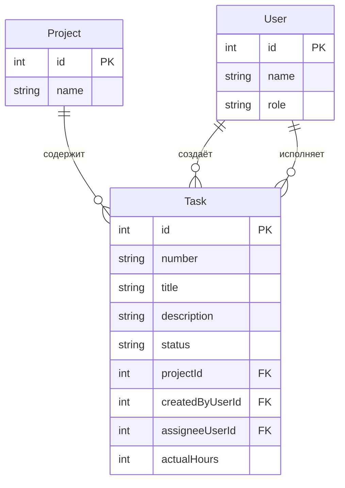

# Модель данных. Система учёта рабочего времени и задач сотрудников проектной организации

## Словарь проекта

| Термин курса | Термин моей темы | Имя в БД и API |
|--------------|------------------|----------------|
| Ticket | Задача | `Task`, `/api/tasks` |
| Site | Проект | `Project` |
| User | Пользователь (сотрудник) | `User` |

Дальше во всех документах используем только `Task`, `Project`, `User`.

---

## Сущности и поля

### Task (задача) — главный объект

| Поле | Тип | Ключ | Описание |
|------|-----|------|----------|
| `id` | число | **PK** | машинный первичный ключ, генерируется БД |
| `number` | строка | — | человеческий номер, например `TASK-2026-0001` |
| `title` | строка | — | заголовок задачи (5–80 символов) |
| `description` | строка | — | описание задачи (10–500 символов) |
| `status` | строка | — | `New` / `InProgress` / `Closed` / `Cancelled` |
| `projectId` | число | **FK** | ссылка на проект (`Project.id`) |
| `createdByUserId` | число | **FK** | кто создал задачу (`User.id`) |
| `assigneeUserId` | число | **FK** | на кого назначена (`User.id`), может быть пустым |
| `actualHours` | число | — | фактически затраченные часы, заполняется при закрытии |

### Project (проект) — справочник

| Поле | Тип | Ключ | Описание |
|------|-----|------|----------|
| `id` | число | **PK** | машинный первичный ключ |
| `name` | строка | — | название проекта |

### User (пользователь)

| Поле | Тип | Ключ | Описание |
|------|-----|------|----------|
| `id` | число | **PK** | машинный первичный ключ |
| `name` | строка | — | имя сотрудника |
| `role` | строка | — | `Manager` (руководитель) / `Employee` (сотрудник) / `Director` (директор) |

---

## Связи

- **Project 1 : N Task** — один проект содержит много задач. В задаче хранится `projectId`, а не название проекта.
- **User 1 : N Task (createdByUserId)** — один пользователь создаёт много задач.
- **User 1 : N Task (assigneeUserId)** — один пользователь может быть назначен на много задач.
- **Task.assigneeUserId — необязательный** — у новой задачи исполнителя может ещё не быть (статус `New`).

---

## ER-диаграмма

---

## Проверка 3НФ (третья нормальная форма)

**Название проекта хранится в сущности `Project` один раз.** В таблице `Task` хранится только внешний ключ `projectId` (число). Если проект переименовать — меняется одна строка в `Project`, а не все задачи этого проекта. Поэтому название проекта не дублируется в каждой задаче.

Аналогично: имя пользователя хранится только в `User`. В `Task` — только `createdByUserId` и `assigneeUserId` (числа). Переименование сотрудника не затрагивает задачи.

Это и есть 3НФ: каждый факт хранится в одном месте, дублирования текстовых значений нет.