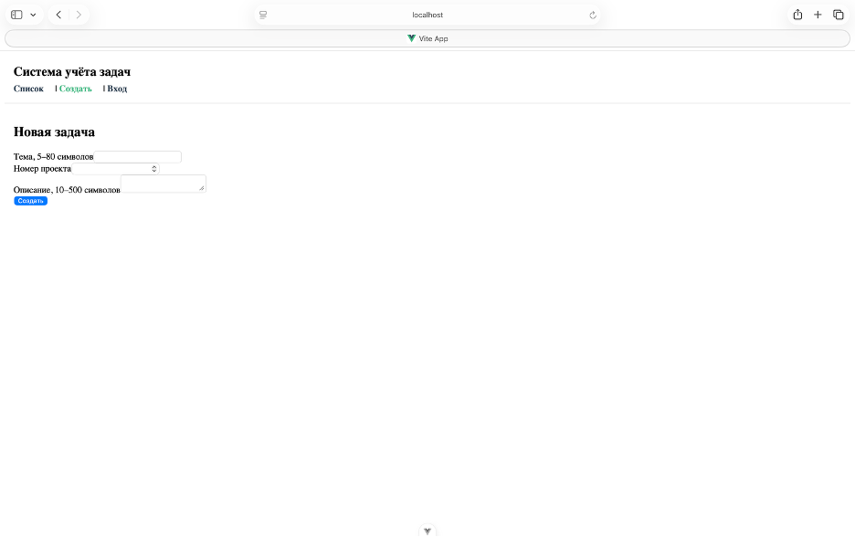

# Отчёт по ЛР4: Компоненты и маршруты

## 1. Доказательства работы маршрутов



Все три адреса проверены ручным вводом (Enter в адресной строке):
- `/` — открывается список задач.
- `/new` — открывается форма создания.
- `/login` — открывается форма входа.

## 2. Дерево файлов `src/`

```text
src/
├── main.js
├── App.vue
├── router.js
├── taskStore.js
├── components/
│   ├── AppHeader.vue
│   └── TaskTable.vue
└── pages/
    ├── TaskList.vue
    ├── TaskNew.vue
    └── Login.vue